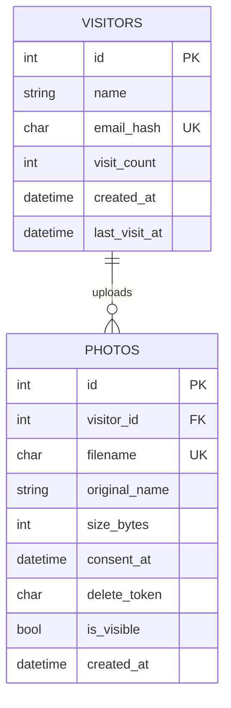
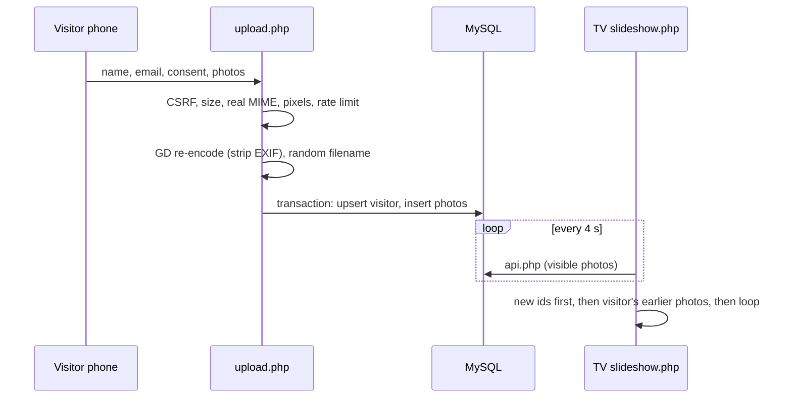

# Architecture

## Stack and reasons
- **PHP + MySQL (phpMyAdmin)** – required for the course, runs on XAMPP and cheap hosting.
- **Bootstrap 5** – responsive form with little custom CSS; custom CSS gives the Snap Wall look.
- **Polling JSON (`api.php`)** – works on any TV browser, no extra server. Trade-off: up to 4 s delay and one small request per display every 4 s.
- **GD** – ships with PHP; used to re-encode, rotate by EXIF and resize.

## Data model

## Flow

## Security notes
Prepared statements everywhere; output escaped with `e()`; CSRF token on POST forms; `uploads/.htaccess` blocks script execution; `.env` is git-ignored.
